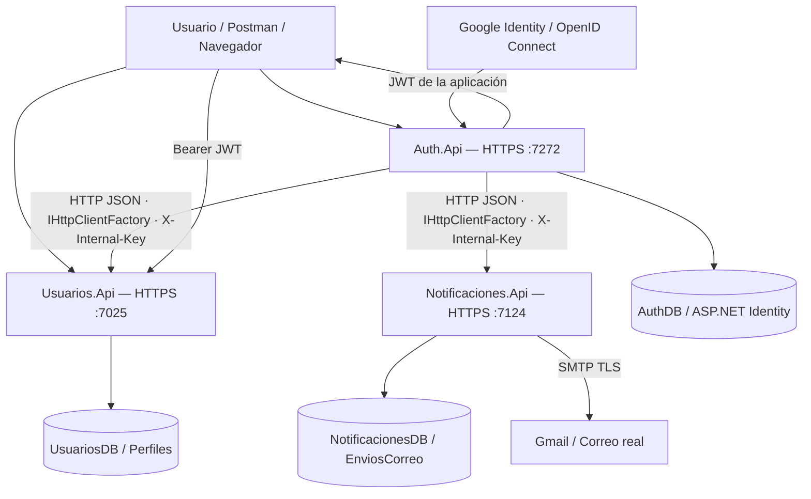

# Diagrama de arquitectura — AA01

- Las tres APIs funcionan como proyectos independientes, con bases de datos aisladas.
- `Auth.Api` genera y firma JWT; `Usuarios.Api` verifica la firma, el emisor, la audiencia y la expiración.
- `Notificaciones.Api` no expone el envío libremente: requiere una clave interna de servicio.
- Este diagrama muestra las conexiones funcionales de la implementación; no sustituye las pruebas realizadas en clase.
